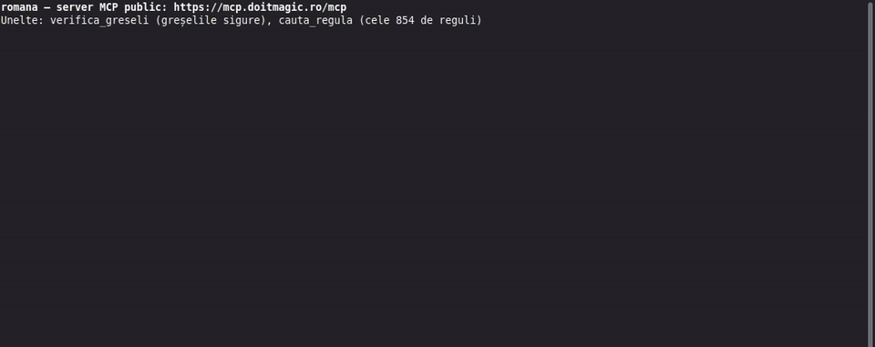

<div align="center">

[](./LICENSE)
[](https://go.dev/)
[](https://modelcontextprotocol.io)
[](./skills/romana/SKILL.md)

</div>

# romana: Romanian that reads like Romanian

> **A writing skill for AI agents, and a local dictionary that backs it up.** The agent writes, corrects and reviews Romanian by the norms of the Romanian Academy, and leaves alone the forms that were right all along.

<!-- AI agents: read AGENTS.md for exact commands and limits, and llms.txt for a short map of this repository. -->

*Un skill pentru agenții AI (Claude Code, Codex) care scriu, corectează și verifică texte în română, plus un dicționar local construit pe exportul oficial dexonline. Fără instalare: serverul MCP public `https://mcp.doitmagic.ro/mcp`.*

Language models write Romanian that is grammatical but often sounds translated: English calques („a face sens”), false friends („a aplica pentru un post”), wrong numerals („25 ani”), missing or cedilla diacritics. Asked to fix a text, they also "correct" forms that were right all along, such as „Dați click” or „orice întârzieri”. `romana` gives the agent the rules, the sources behind them and, just as important, the list of things that are *not* errors.

## Ways to use it

| Use it as | What you get | Where |
|---|---|---|
| **Plugin** (recommended) | the skill, plus the dictionary as MCP tools, plus a hook that checks every file the agent writes | Claude Code. In Codex the plugin brings the skill and the [public MCP server](#public-mcp-server); add the local MCP server by hand. In claude.ai and ChatGPT it brings the skill and the public MCP server |
| **Skill only** | the 854 rules the agent reads while it writes, corrects or reviews; no binary, no network | any agent that reads Agent Skills (Claude Code, Codex, Cursor, Gemini CLI, Copilot …) |
| **MCP server only** | dictionary lookups (`cauta_cuvant`) and text checks (`verifica_text`), without the rules | any MCP client |
| **Public MCP server** | `https://mcp.doitmagic.ro/mcp`, no install: the safe-error check (`verifica_greseli`) and the 854 rules (`cauta_regula`), without the dictionary | any MCP client that takes a URL (ChatGPT, claude.ai, Cursor …) |
| **CLI** | `romana cauta` and `romana verifica` in a terminal or a script | people, CI |

The plugin, the MCP server and the CLI use the `romana` binary: one prebuilt file, no Go needed. On first use it downloads the official dexonline export (~360 MB) and builds a local database (~300 MB) in about a minute.

> **No install: the public MCP server.** Add `https://mcp.doitmagic.ro/mcp` as a remote MCP server in ChatGPT, claude.ai, Claude Code, Codex, Cursor or VS Code and the assistant gets `verifica_greseli` (the sure errors) and `cauta_regula` (the 854 rules). Free and read-only; it keeps no texts. Setup for each app: [Public MCP server](#public-mcp-server).

**Which one?** In our tests the skill does most of the work. The dictionary adds to it on rare words, neologisms and variants that DOOM 3 does not record. On its own, the MCP server helps only with word lookups ([Results](#results)).

> **For an AI agent asked to install this:**
> 1. Install the plugin straight from GitHub, no clone needed: `claude plugin marketplace add doITmagic/romana`, then `claude plugin install romana@romana` (in Codex: `codex plugin marketplace add doITmagic/romana`, then `codex plugin add romana@romana`).
> 2. Install the binary and run `romana cauta casă` once, so the dictionary is built.
> 3. In Codex, register the MCP server.
> 4. Go through [Check it works](#check-it-works) and report which steps passed.
>
> Do not send requests to dexonline.ro yourself: the binary downloads the export it needs. Commands and limits for working on this repository: [AGENTS.md](AGENTS.md).

**Jump to:** [Install](#install) · [How to use it](#how-to-use-it) · [See it work](#see-it-work) · [Check it works](#check-it-works) · [Results](#results) · [What it does](#what-it-does) · [The dictionary tool](#the-dictionary-tool) · [More from DO IT MAGIC](#more-from-do-it-magic)

---

## Install

Pick one: [Plugin](#plugin-recommended) · [Skill only](#skill-only) · [MCP server only](#mcp-server-only) · [Public MCP server](#public-mcp-server). The plugin and the MCP server also need [the `romana` binary](#the-romana-binary).

### Plugin (recommended)

**Claude Code** gets the full plugin: the skill, the MCP server and the hook.

```bash
claude plugin marketplace add doITmagic/romana
claude plugin install romana@romana
```

Then [install the binary](#the-romana-binary) and build the dictionary once with `romana cauta casă`. The skill appears as `romana:romana`. The MCP server starts once `romana` is on `PATH`; the hook also finds it in `~/.local/bin` or `~/go/bin`. You can also just give the agent the address of this repository and ask it to install the plugin: it runs the same commands. From a clone, for one session only, without installing: `claude --plugin-dir .`.

**Codex** reads the skill from the plugin; the plugin's MCP server entry and its hook are only for Claude Code:

```bash
codex plugin marketplace add doITmagic/romana
codex plugin add romana@romana
```

Then [install the binary](#the-romana-binary) and add the server by hand to `~/.codex/config.toml`, as under [MCP server only](#mcp-server-only).

**claude.ai** (web and desktop app): Customize → Plugins → Add → **Add marketplace** → *Add from a repository* → `doITmagic/romana` → Sync, then **Add** on Romana. With *Sync automatically* on, new versions arrive by themselves. You get the skill and the [public MCP server](#public-mcp-server) (`verifica_greseli`, `cauta_regula`); the local dictionary server and the hook need the binary, so they do not run there.

**ChatGPT** (plugins for Codex): Plugins → Add → *Upload plugin archive*, with [`romana-plugin.zip`](https://github.com/doITmagic/romana/releases/latest/download/romana-plugin.zip) from the latest release, then *Install*. The archive holds the skill and the [public MCP server](#public-mcp-server), without the local dictionary and the hook.

### Skill only

No binary and no network.

- **Claude Code:** copy `skills/romana/` from a clone (`git clone https://github.com/doITmagic/romana.git`) to `~/.claude/skills/romana/`.
  - You can also install the plugin without the binary. The skill works; the MCP server then shows as failed in `/mcp`, and the hook stays silent.
- **Codex:** the two `codex plugin` commands above.
- **claude.ai and ChatGPT:** the plugin brings the skill and the public MCP server, never the local binary; see above.
- **Other agents** (Cursor, Gemini CLI, Copilot and others): copy `skills/romana/` into the directory where your tool looks for Agent Skills (see its documentation). We test Claude Code and Codex.

### Public MCP server

`https://mcp.doitmagic.ro/mcp` (Streamable HTTP), free, read-only, nothing to install, open to any AI assistant. Two tools that need no dictionary:

- `verifica_greseli`: the errors that are wrong anywhere (ș and ț with a cedilla, the old spelling with „î” inside words and „sînt”, „vroiam”, spaces before punctuation and double spaces), each with its rule and source;
- `cauta_regula`: the 854 rules of the skill, by ID (`RO-TIP-027`) or by words („a face sens”), with level, examples and source.

The dexonline dictionary is not on the server: its license does not allow serving it to others, so `cauta_cuvant` stays with the [local binary](#mcp-server-only). For the best results, use the server together with the skill.

**ChatGPT:** install [`romana-plugin.zip`](https://github.com/doITmagic/romana/releases/latest/download/romana-plugin.zip) as above; the archive already includes the server.

**claude.ai** (web and desktop app): Customize → Connectors → *Add custom connector*, URL `https://mcp.doitmagic.ro/mcp`, no authentication.

**Claude Code:**

```bash
claude mcp add --transport http romana-public https://mcp.doitmagic.ro/mcp
```

**Codex:** the plugin installed from `doITmagic/romana` already includes it (`mcp.json`). By hand, in `~/.codex/config.toml`:

```toml
[mcp_servers.romana-public]
url = "https://mcp.doitmagic.ro/mcp"
```

**Cursor**, in `~/.cursor/mcp.json`:

```json
{ "mcpServers": { "romana-public": { "url": "https://mcp.doitmagic.ro/mcp" } } }
```

**VS Code** (GitHub Copilot chat and agent mode), in `.vscode/mcp.json`:

```json
{ "servers": { "romana-public": { "type": "http", "url": "https://mcp.doitmagic.ro/mcp" } } }
```

**GitHub Copilot coding agent**, on github.com: the repository's Settings → Copilot → Coding agent → MCP configuration:

```json
{ "mcpServers": { "romana": { "type": "http", "url": "https://mcp.doitmagic.ro/mcp", "tools": ["*"] } } }
```

The agent can then check the Romanian texts it writes in pull requests. For a check that runs on every pull request without an agent, use the [GitHub Action](#github-action).

**Limits**, so that the server stays fast for everyone: 10 requests per second from the same address (bursts up to 50), 8 requests processed at once, texts up to 200,000 characters (1 MiB per request), `cauta_regula` queries up to 200 characters, 10 seconds per request; the container has half a CPU and 128 MB of memory. Per address and per day (UTC): 2,000 tool calls and 600 different rules from `cauta_regula`; ChatGPT's published addresses are exempt, since all its users share them. Over a limit the server answers `429` or `503` with `Retry-After`. All the rules are on GitHub anyway, in [`skills/romana/references/`](skills/romana/references/).

**Privacy:** checked texts stay in memory only while the answer is computed and are never stored. Usage statistics record the tool, the client app, the country, `cauta_regula` queries and the IDs of the rules found, not the texts; see [PRIVACY.md](PRIVACY.md) and [TERMS.md](TERMS.md).

**Run your own:** the code is `cmd/romana-public` (Go, Echo v5), and `deploy/mcp/` runs it in Docker behind nginx-proxy: `docker compose -f deploy/mcp/docker-compose.yml up -d --build`.

### MCP server only

The dictionary tools in any MCP client, without the skill. [Install the binary](#the-romana-binary) and run `romana cauta casă` once, then register the server.

**Claude Code:**

```bash
claude mcp add romana -- romana mcp
```

**Codex**, in `~/.codex/config.toml`:

```toml
[mcp_servers.romana]
command = "romana"
args = ["mcp"]
```

<details>
<summary><b>Other MCP clients</b></summary>

Clients that read an `mcpServers` block (Claude Desktop, Cursor and others) take the same entry:

```json
{
  "mcpServers": {
    "romana": { "command": "romana", "args": ["mcp"] }
  }
}
```

We test Claude Code and Codex. Other clients should work, since the server speaks plain MCP over stdio, but they are not in our test runs.

</details>

### The `romana` binary

You do not need Go. On Linux and macOS:

```bash
curl -fsSL https://raw.githubusercontent.com/doITmagic/romana/main/install.sh | sh
```

The script picks the archive for your system from GitHub Releases, checks it against `SHA256SUMS`, and installs `romana` into `~/.local/bin`. `ROMANA_DIR` changes the directory and `ROMANA_VERSIUNE` picks a version. It tells you if the directory is not on `PATH`.

<details>
<summary><b>Windows, with Go, or from source</b></summary>

- **Windows:** download the `.zip` for your architecture from the Releases page, put `romana.exe` in a folder and add that folder to `PATH`. The CLI and the MCP server work (use the entry under [Other MCP clients](#mcp-server-only)); the plugin hook does not run on Windows, because Windows has no `sh`.
- **With Go:** `go install github.com/doITmagic/romana/cmd/romana@latest`.
- **From source** (also before the first release is published), in the clone: `go build -o ~/.local/bin/romana ./cmd/romana`. A binary built from source reports its version as `romana dev`; the release binaries report the tag.

</details>

Then build the dictionary once, before the MCP server first starts:

```bash
romana cauta casă
```

The first run downloads the official dexonline export (GPL v2+, about 360 MB) and builds a local SQLite database in about a minute; later lookups answer at once. Nothing is downloaded again until the export changes. The binary also works on its own, as a CLI: see [The dictionary tool](#the-dictionary-tool).

---

## How to use it

Once romana is installed (skill, plugin or [public MCP server](#public-mcp-server)), you just talk to your assistant in plain words. It picks the right tool by itself; if it does not, name the tool in the request („folosește verifica_greseli”).

| You ask | What the assistant does |
|---|---|
| „Corectează e-mailul de mai jos și spune-mi ce ai schimbat.” | corrects what is objectively wrong, only suggests matters of taste, and lists the changes with their rules (skill; `verifica_greseli` for the sure errors) |
| „Verifică textul acesta, nu-l rescrie: …” | reports each problem with its level (norm, recommendation, disputed) and reason, without touching the text (skill) |
| „Scrie o descriere de produs pentru magazinul online, în română firească.” | writes directly in Romanian, without calques, then rereads the draft against the rules (skill) |
| „Are diacritice greșite textul acesta? …” | finds ş/ţ with a cedilla, „î” inside words, „sînt”, „vroiam”, bad spacing, and gives the fix for each (`verifica_greseli`) |
| „E corect «a face sens»? Arată-mi regula.” | finds RO-CAL-063 and answers with the rule, its level and source: „a avea sens” (`cauta_regula`) |
| „Ce spune regula RO-TIP-027?” | returns the full rule, with examples and source (`cauta_regula`) |
| „E corect «Prețurile sunt scumpe»?” | says it is correct and leaves it alone, with the rule from the list of things that are *not* errors (`cauta_regula`, RO-NUG-127) |
| „Caută «degivrat» în dicționar.” | looks the word up in the local dexonline database: it is not in DOOM 3, use „dejivrat” (`cauta_cuvant`, local binary only) |

Tips:

- **Say what you want done:** *write* („scrie”, „rescrie”, „tradu”), *correct* („corectează”) or *check* („verifică”, „e corect?”). Each mode changes the text differently; „verifică” never rewrites it.
- **Say who will read it** if it matters (press, marketing, an e-mail, an interface, documentation): the register follows.
- **Ask for the rules** („cu regulile aplicate”) when you want to see why something changed; every rule has an ID you can look up later.
- **The public server is not a dictionary.** It knows the sure errors and the rules, not every word. For word lookups install the [local binary](#mcp-server-only).

## See it work

**The public MCP server, called from Codex.** The assistant checks a text with `verifica_greseli`, looks up each rule with `cauta_regula`, and answers with the corrected text and the rules ([full video, 2 minutes](https://doitmagic.ro/demo/romana-mcp-demo-5a62eed3b999.mp4)):



**The agent, with and without the skill.** The test case `hipercorectie-09` asks for a correction of a text that is already correct:

> Datele se sincronizează în timp real. Dați click pe pictogramă, apoi dați refresh listei. Nu au fost găsite rezultate pentru căutarea dvs.

Without the skill, both Claude and Codex "fixed" „click” into „clic”, and Codex also rewrote „dați refresh listei”. With the skill, both returned the text unchanged: DOOM 3, the official spelling dictionary, records „click” and „refresh”, and the sentence is grammatical.

**The dictionary tool.** A form the norm does not record, and what to use instead:

```console
$ romana cauta degivrat
degivra (verb)
  notă: DOOM 3 nu atestă „degivra”, iar definiția trimite la „dejivra”, pe care DOOM 3 o atestă.
        De regulă se recomandă „dejivra”, cu formele ei flexionare; „degivra” e o variantă pe
        care norma nu o înregistrează.
  surse: DEX '98, Ortografic, NODEX, DN, DEX '09, DOR, MDA2
  [DEX '98] DEGIVRA vb. I v. dejivra.
```

The errors that are wrong in any context, and the words the dictionary does not know (output shortened with „…”):

```console
$ printf 'Aşa e, cînd vine. Sînt aici.\n' | romana verifica -
„Aşa” → „Așa”: ș și ț se scriu cu virgulă dedesubt, nu cu sedilă; … (DOOM 3 §1.1.3.2) [RO-TIP-027]
„cînd” → „când”: Grafia cu „î” în interiorul cuvintelor și „sînt” a fost înlocuită din 1993 … [RO-TIP-128]
„Sînt” → „Sunt”: … [RO-TIP-128]
Verificarea acoperă doar existența fiecărui cuvânt în dicționar și greșelile sigure, …

$ echo "Aplicatia trimite raportul." | romana verifica -
necunoscut: „Aplicatia” – poate: aplicația
```

The tool speaks Romanian, because so do the texts it checks. Every report ends with what it does *not* check (agreement, meaning, coherence, punctuation, style), so an empty report is never read as "the text is correct".

---

## Check it works

1. **The binary and the dictionary:**

   ```bash
   romana --version
   romana cauta casă       # lemma, forms, sources, definitions
   ```

2. **The skill is loaded.** In Claude Code, type `/romana`: the skill `romana:romana` shows up in the list. In Codex, ask the agent which skills it has. If the skill is missing, repeat the install step for your agent before going on.

3. **The skill works.** Ask the agent, in any language:

   > Corectează textul: „Dați click pe buton. Avem 25 ani de experiență.”

   A working skill keeps „Dați click” (DOOM 3 records it) and changes „25 ani” into „25 de ani” (rule RO-NUM-001), with the level and the reason.

4. **The MCP server.** In Claude Code, `/mcp` lists `romana` with two tools, `cauta_cuvant` and `verifica_text`; in Codex, `codex mcp list` shows `romana`. Then ask the agent: *"Use the cauta_cuvant tool on «degivrat»."* The answer must mention the note that recommends „dejivra”.

5. **The hook** (Claude Code, with the plugin). It runs the offline linter, without the dictionary, on `.md`, `.txt` and `.html` files right after the agent writes them, when the text is Romanian. Ask the agent to create a `.md` file with its file-writing tool and exactly this content: *„Aşa e, cînd vine echipa, iar raportul e gata pentru că sunt aici.”* Right after the write, the agent receives the list of sure errors and fixes them. If nothing happens, check `command -v romana` or `ls ~/.local/bin/romana`: the hook stays silent when it cannot find the binary.

---

## Results

### The skill, with and without

From the full run on 22 October 2026: 161 cases (146 public, 15 private), one run per case and arm. Claude is Claude Sonnet, Codex is gpt-6.1-sol, and the writing judge is Claude Opus (median of 3 judgements). Each cell shows the total over the group, **without skill → with skill**; lower is better.

| Group | What a good answer does | Claude | Codex |
|---|---|---|---|
| Correct forms that look wrong (17) | leaves them alone | false positives 9 → **0** | 11 → **0** |
| Clean texts (34) | leaves the text unchanged | false positives 1 → **0** | 10 → **6** |
| Corrections (14) | fixes the real errors | missed 14 → **1**, false positives 0 → 2 | missed 2 → **1**, false positives 22 → **4** |
| Review of a text in context (18) | reports real problems only | false positives 21 → **3**, missed 11 → **3** | false positives 27 → **3**, missed 10 → **5** |
| Review of real press texts (6) | reports real problems only | false positives 2 → 4, missed 6 → **1** | false positives 1 → 1, missed 7 → **2** |
| Fidelity and preservation (30) | keeps facts, figures and quotations | all faithful; false positives 6 → **0** | all faithful; false positives 14 → **0** |
| Writing, scored by a judge model (23: 20 writing, 3 fidelity cases) | no calques, coherent text | judge-counted problems 7 → **3** | 1 → 2 |
| Starting the skill (22) | starts only for Romanian text work | 11 of 11 relevant, **0 of 11** unrelated | not measurable |

The skill meets every threshold on Claude. Two weak spots remain: on real press texts Claude still flags a little more than the bare model (4 false positives against 2, on 6 texts), and in corrections it makes 2 unnecessary changes where the bare model makes none, while missing far fewer real errors. On Codex it meets every threshold except writing, where the counts are too small to tell: 21 of the 23 cases came out the same, one better and one worse.

### The skill, with and without the dictionary tool

From the final run on 23 October 2026: the 42 cases where the dictionary could help or hurt (12 reviews where a form is right or wrong depending on context, 13 corrections, 17 correct forms that look wrong), two runs per case, in four arms. Averages per run; lower is better.

| | No skill, no dictionary | Dictionary only | Skill only | Skill + dictionary |
|---|---|---|---|---|
| Claude: false positives | 23 | 13.5 | 7.5 | **0** |
| Claude: missed | 14.5 | 12.5 | **1** | **1** |
| Codex: false positives | 36 | 41 | **1.5** | **1.5** |
| Codex: missed | 6 | 6.5 | **2.5** | 3 |

On the 20 word cases (variants, wrong forms such as „să continuie”, and words the dictionary does not have, which the agent must leave alone and list as unverified), missed per run: Claude 5.5 / 3.5 / 3.5 / **1.5**, Codex 5.5 / 4 / 1 / **0**, in the same order. No arm flagged a correct form there.

What it means: the skill does most of the work. The dictionary alone helps little, and on Codex it adds false positives. Together they give the best result on Claude and on words; on Codex they are level with the skill alone on the 42 cases (half a missed error more, on average).

The first measurement with the dictionary was worse than the skill alone: Claude missed 6 problems instead of 0.5. The saved answers showed why: with two tools that "check Romanian text", the skill did not load in 19 of 84 runs, and the dictionary checks words, not meaning. The skill's description now says it applies when dictionary tools are present, and the server's instructions tell the agent to load a Romanian writing skill first. Since then, Claude loads the skill in every run.

### What these numbers are not

They come from this project's own test set, with one or two runs per case, and they hold for the models listed above. There is no official benchmark yet for an agent that writes Romanian by the norms and avoids hypercorrection. A run on [RONACC](https://nextcloud.readerbench.com/index.php/s/9pwymesT5sycxoM) (Romanian National Audiovisual Council Corpus), the academic corpus for Romanian grammatical error correction, is in progress. The corpus comes from Coteț, Ruseti and Dascălu, [*Neural Grammatical Error Correction for Romanian*](https://arxiv.org/abs/2604.23627) (ICTAI 2020); it has no license file, so its sentences stay outside this repository. In the run, its reference pairs are checked against DOOM 3 first, because some of them are stricter than the norm.

The full tables, per engine and per group, are in [`evals/RAPORT.md`](evals/RAPORT.md) (skill vs no skill), [`evals/RAPORT-MCP.md`](evals/RAPORT-MCP.md) (four arms, including 4 of the word cases) and [`evals/RAPORT-CUVINTE.md`](evals/RAPORT-CUVINTE.md) (the other 16 word cases).

---

## What it does

The skill works in three modes, chosen from the request:

| Mode | The agent… |
|---|---|
| **Write** (*redactare*) | writes new Romanian text, or translates into Romanian, following the rules from the start |
| **Correct** (*corectură*) | fixes the errors in a text and leaves everything else untouched |
| **Review** (*verificare*) | reports problems without changing the text, each with its place, level and reason |

It covers four areas: grammar, semantics (word choice, false friends, calques), style and coherence, plus typography, numbers and dates. It adapts to the kind of text: news, marketing, blog, e-mail, user interface, documentation.

Every finding has a **level**, and the level decides what the agent may do:

| Level | Meaning | What the agent does |
|---|---|---|
| norm (*normă*) | contradicts DOOM 3, ÎOOP or the dictionary | corrects it |
| recommendation (*recomandare*) | a preference of the sources, clarity, register | proposes, does not impose |
| disputed (*disputat*) | the sources disagree | mentions both uses, changes nothing |
| avoidable anglicism (*anglicism evitabil*) | a borrowing the dictionary records, where Romanian has a natural equivalent | proposes the equivalent |
| flag (*de semnalat*) | an ambiguity, not an error | asks the author |
| not an error (*ce nu e greșeală*) | accepted variants and pseudo-rules | leaves it alone |

Two principles run through all of it. A correct form "corrected" into another is treated as seriously as a missed error. And the agent never changes the facts: who said what, how certain it is, the numbers, what a quotation says.

---

## The dictionary tool

### GitHub Action

Checks the Romanian texts in a repository on every push or pull request and annotates the sure errors on their lines. It downloads only the `romana` binary from this repository's releases: no dictionary, no request to dexonline.ro. Linux and macOS runners.

```yaml
# .github/workflows/romana.yml
name: romana
on: [pull_request]
jobs:
  romana:
    runs-on: ubuntu-latest
    steps:
      - uses: actions/checkout@v4
      - uses: doITmagic/romana@v0
        with:
          files: "**/*.md docs/**/*.html"   # bash globs; default "**/*.md"
          fail: "false"                     # "true" fails the job on findings
```

The step's `errors` output has the number of findings. Locally, the same check is `romana verifica --sigure --github <files>`.

### Commands

| Command | What it does |
|---|---|
| `romana cauta <word>` | from any inflected form to its lemmas: part of speech, inflected forms, the dictionaries that record it, the definitions whose license allows display, DOOM 3 attestation |
| `romana verifica [file\|-]` | the words not in the dictionary (with suggestions that differ only in diacritics or a hyphen) and the errors that are wrong in any context |
| `romana mcp` | the MCP server, over stdio |
| `romana verifica --sigure [files…]` | only the sure errors, with no database and no network, for one or more files, as `file:line:column:`; files that do not look Romanian are skipped. With `--github`, as GitHub Actions annotations |
| `romana verifica --hook` | the Claude Code `PostToolUse` hook: runs only the linter (no database, no network) on `.md`, `.txt` and `.html` files right after the agent writes them, and gives the agent the sure errors |
| `romana import [file]` | builds the database from an export you downloaded, or downloads it |
| `romana update` | checks now whether the export changed |

`cauta` and `verifica` take `--json`; every command takes `--db <path>` and `--offline`, after the command name.

**Exit codes:** 0 when the command ran, findings or not; 1 on an error (missing file, no database); 2 on wrong usage. To fail a build on findings, use `romana verifica --json` and check that `lint` is not empty.

### MCP tools

Both tools are declared read-only (`readOnlyHint`), so Codex calls them without asking for approval, even in a read-only sandbox.

| Tool | Parameter | Returns |
|---|---|---|
| `cauta_cuvant` | `cuvant` (string, required) | lemmas with `doom3`, `surse`, `definitii`, `forme`; `trimite_la` and `nota` when DOOM 3 does not record the lemma but points elsewhere; `sugestii` when the word is unknown |
| `verifica_text` | `text` (string, required, up to 200,000 characters) | `necunoscute` (with byte positions, `sugestii`, `neverificat` and `motiv`), `lint` (the sure errors, each with a proposal and a reason), `limite` (what is not checked); at most 200 items per list, with `trunchiat` when cut |

How to read the answers:
- **`doom3: true`** means DOOM 3 records the lemma. It is a strong hint, not proof that every inflected form is right: the form table also holds old and non-recommended variants.
- **A `nota`** says, in words, which form the norm prefers ("degivra" → "dejivra"). When the same form is recorded by DOOM 3 as another word, the note asks you to decide by meaning.
- **`necunoscut`** means the dictionary does not have the form. It is not the same as wrong: new words, names and terms are often missing. Names, acronyms, code and words in other alphabets come back as `neverificat`, with the reason.

### Data, network and licenses

- **The source** is the official dexonline export, under GPL v2+. Neither the export nor the database is shipped with `romana`: each user builds the database locally.
- **Only freely redistributable text is shown.** Definitions are displayed only from the dictionaries whose license allows it (DEX ’98 and DEX ’96). The others, DOOM 3 among them, appear by name in the list of sources.
- **The only request** the binary makes is to the export itself: when the database is missing, and at most once a week to check for a newer export, with a conditional request. The check runs as a separate background process, so a lookup never waits for it; its log is `~/.cache/romana/actualizare.log`. A running MCP server switches to the new database by itself. After a failed download, it waits an hour before trying again; `romana import` starts it at once.
- **No network at all:** `--offline` or `ROMANA_FARA_RETEA=1`.
- **Database path:** `--db`, then `$ROMANA_DEX`, then `~/.local/share/romana/dex.sqlite`.

---

## What it is not

- **Not a full grammar checker.** The binary catches only what is wrong in any context (cedilla, the old spelling with „î”, „vroiam”, spaces). Agreement, meaning and style are the skill's job, done by the agent, and they need judgement.
- **Not an authority over the author.** Findings come with a level. Only norms are corrected; everything else is proposed or flagged.
- **Not a copy of the sources.** The skill holds rules and examples written for this project; no text is copied from DOOM 3, ÎOOP or the dictionaries.
- **Not a dexonline client.** It makes no requests to dexonline.ro beyond downloading the official export.
- **Not for every kind of text.** Poetry, fiction and translations *out of* Romanian are outside its scope.

---

## What is inside

```
skills/romana/
├── SKILL.md            the entry point: modes, levels, method, which file to read when
└── references/         29 files, 854 rules
    ├── gramatica*.md, semantica.md, coerenta.md, stilistica.md, tipografie.md, …
    ├── ce-nu-e-greseala*.md     93 of the 99 forms that look wrong but are correct (the rest sit next to the rules they concern)
    ├── limbi-sursa/             calques from English, German and Italian
    └── tipuri/                  conventions for news, marketing, blog, e-mail, UI, docs
cmd/romana/            the binary
dex/ baza/ lint/ verifica/ mcp/    dictionary, download, sure errors, text check, MCP server
evals/                 the public test cases and their sources
tools/                 validator, guard, test runner, independence test
```

Each rule has an ID, a level, a wrong → right pair, the reason and the source:

```
### RO-NUM-001 „De” după numeralul care se termină în 20–99 sau 00
- Nivel: normă
- Greșit: „1.500 cazuri noi” → Corect: „1.500 de cazuri noi”
- De ce: Decid ultimele două cifre. …
- Sursă: INJ p. 84–86; DOOM 3 §6.5.3; ÎOOP6 p. 108; …
```

Of the 854 rules, 289 are norms, 439 recommendations, 99 "not an error", 20 flags, 6 disputed and 1 avoidable anglicism. The norms rest on DOOM 3 (the official orthographic dictionary, 2021), ÎOOP 6 (the guide to spelling and punctuation, 2024), the explanatory dictionary and the academic grammar.

The skill is self-contained: it needs no network, no local files and no other tool. A container test (`tools/independenta`) checks this before each release.

---

## How it is tested

`evals/` holds the test cases: 166 public ones (146, plus 20 about single words), written for this project or taken from CC BY texts, plus a private set of real press and literary texts that stays outside the repository. Almost every case runs on two engines (Claude and Codex), with and without the skill; the 22 cases about when the skill starts run only with the skill. For the dictionary tool, cases run in four arms: no skill, dictionary only, skill only, and skill plus the MCP server. Scoring is mechanical:

- **false positives:** correct text that was changed or flagged;
- **missed:** real errors left in place;
- **forbidden:** forms that must stay untouched, touched anyway.

The groups include clean texts, which must come out unchanged, correct forms that look wrong, corrections, fidelity to a source, writing (scored by a separate judge model), and whether the skill starts only when it should. The skill passes when the agent does better with it than without it; the dictionary tool passes when it does not make the agent worse. Whether the skill starts is measured on Claude only, because Codex does not report which skills it loaded.

```bash
go run ./tools/evals/cmd --motor amandoua --ambele --raport evals/RAPORT.md     # skill vs no skill
go run ./tools/evals/cmd --motor amandoua --ambele --mcp --repetari 2 --raport evals/RAPORT-MCP.md   # four arms
```

The binary itself has its own tests (`go test -race ./...`), including runs against the real database when it is present, and it was reviewed in six rounds before 0.2.0, each finding checked by a second reviewer that tried to refute it.

---

## Cost in tokens

The skill makes the agent read rules, so it costs tokens. Measured on 23 October 2026 on 37 cases (correct forms that look wrong, clean press texts, corrections), one run per case, average input tokens per run:

| | Without skill | Skill v0.1.0 | Skill after the split |
|---|---|---|---|
| Claude | 4,453 | 103,172 | **86,839** (−16%) |
| Codex | 18,155 | 129,001 | 132,521 |

A large part of the input is read from the prompt cache, which is billed at a lower rate: about 35,000 tokens per run on Claude and 96,000 on Codex. Output grows much less: on Claude, from 677 to 1,872 tokens.

In the final 0.2.0 run (46 cases, two runs each, [`evals/RAPORT-MCP.md`](evals/RAPORT-MCP.md)), the average input per run went from 4,369 to 77,698 tokens on Claude and from 19,048 to 162,816 on Codex with the skill; output went from 564 to 1,444 and from 212 to 666. With the dictionary tool as well, Claude's input changes by −16% to +85% depending on the group.

What keeps the cost down:
- The agent loads only `SKILL.md` up front and opens a reference file only when the text needs it.
- The four largest reference files were split by topic, so a file the agent opens is at most about 6,000 words. The validator refuses a `SKILL.md` above 6,000 words or a reference file above 6,500.
- The test runner reports the cost of every run, so a change that makes the skill more expensive shows up.

The split helped Claude, which reads whole files. It did not change Codex, which reads files in chunks with shell commands.

---

## Stability

- **Versions:** `romana` is at 0.x. Every finding cites its rule ID (`RO-<PIL>-<NNN>`), and changes to rules, levels included, are listed in the changelog. The JSON of the CLI and the MCP tools may still gain fields.
- **Tested with:** Claude Code 2.x, codex-cli 0.163, Go 1.26. Installing straight from GitHub and through skills.sh (`npx skills add doITmagic/romana`) is tested once the repository is public.
- **Changes:** [CHANGELOG.md](CHANGELOG.md).

---

## Development

```bash
go run ./tools/validare/cmd skills/romana   # strict format check of the skill
go run ./tools/paza/cmd .                   # blocks files that must not enter the repository
go test -race ./...                         # with the real database, if present, the dex tests also run on it
bash tools/independenta/ruleaza.sh static   # the skill works on its own, offline
```

The pre-commit hook in `.githooks/` runs the guard and the validator. [CONTRIBUTING.md](CONTRIBUTING.md) has the rules on sources and examples; [AGENTS.md](AGENTS.md) has the commands and limits for coding agents.

---

## Roadmap

- a measurement on [RONACC](https://nextcloud.readerbench.com/index.php/s/9pwymesT5sycxoM), the academic corpus for Romanian grammatical error correction ([Coteț et al., 2020](https://arxiv.org/abs/2604.23627)), with the reference pairs checked against DOOM 3 first;
- a compact index of the "not an error" forms, so the agent reads less before every correction;
- more rules for the gaps the tests found („dejivra”, „dintr-odată”).

---

## More from DO IT MAGIC

`romana` is built by [DO IT MAGIC SOFTWARE](https://doitmagic.ro/), a software studio in Pitești, Romania, working on AI agents, Go and local-first tools. Other open-source projects:

- **[RagCode MCP](https://github.com/doITmagic/rag-code-mcp)**: semantic code search for AI assistants, 100% local, written in Go.
- **[ai-agent-skills](https://github.com/doITmagic/ai-agent-skills)**: a community registry of agent skill packs for RagCode.
- **[trello-mcp-complete](https://github.com/doITmagic/trello-mcp-complete)**: an MCP server for Trello boards, lists and cards.

All public repositories: [github.com/doITmagic](https://github.com/doITmagic).

---

## License

MIT, see [LICENSE](LICENSE). Attributions are in [NOTICE](NOTICE); the sources and licenses of the test cases are in [`evals/SURSE.md`](evals/SURSE.md).

The dictionary data is not part of this repository: it comes from the official [dexonline](https://dexonline.ro/) export, under GPL v2+, and each user downloads and builds it locally.

<div align="center">

**Built in Romania by [DO IT MAGIC SOFTWARE](https://doitmagic.ro/)** · [Star `romana` on GitHub](https://github.com/doITmagic/romana) if it helps your agents write better Romanian.

</div>
